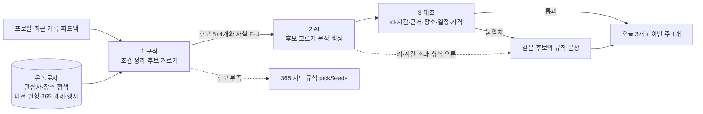

# AI 미션 추천 구조

> 기준: 최종 제출 기획서 "AI 활용 방법 — 미션 추천"(프로필·최근 기록·365 과제·생활권 행사를 개념 구조로 정리해 넣고, 맞춤 미션과 추천 이유를 정해진 형식으로 생성) · 미션 데이터: 마이서울루틴 공공정책 연계 미션 목록(2026-10-27) · 코드: `supabase/functions/_shared/recommend/`

## 1. 한 줄 요약

규칙이 **해도 되는 후보**를 거르고, AI는 **그 후보 안에서** 행동·시간·추천 이유를 정해진 형식으로 쓰고, 결과를 **후보의 사실과 대조**해 하나라도 어긋나면 그 미션만 **규칙 문장으로 대체**한다.



## 2. 온톨로지 (개념과 관계)

| 개념 | 내용 | 정의 위치 |
| --- | --- | --- |
| 관심사 | 걷기·자연·책·전시·배움·진로·사진·새활용·환경·생활 리듬·사람 등. 온보딩 카테고리에서 유도, `preferences.routine.interests`가 있으면 우선 | `catalog.ts` `CategoryInterests` |
| 정책·사업 | 365 서울챌린지, 손목닥터9988, 공공도서관, 서울시립미술관, 평생학습포털, 청년몽땅정보통, 새활용플라자, 에코마일리지, 외로움 없는 서울, 자원봉사센터 (공식 링크) | `Policies` |
| 장소 | 이름·종류·자치구·소속 정책·확인 여부. 생활권에 이름 있는 장소가 없으면 '가까운 공공도서관'·'집 근처 공원' 같은 일반 장소로 대체 | `Places`, `GenericPlaces`, `OnlinePlaces` |
| 미션 원형 33개 | 미션 목록 144개 항목에서 겹치는 것을 묶은 틀. 장소 종류·관심사·활동 시간 범위·교류 수준·난이도·선행 조건 | `Archetypes` |
| 365 과제 36개 | DB `missions(source='seed')`. 장소 없는 원형으로 함께 후보가 된다 | `data/seoul-challenge-2026-2.json` |
| 생활권 행사 | DB `events`. 같은 구·이번 주 안에 진행 중인 것만 주간 후보 | `events` 테이블 |
| 최근 기록 | `user_missions` 14일 + 추천 이력(`preferences.routine.recent`) | `supabase.ts` |
| 피드백 | '다른 미션 보기' 사유: `time_short` 시간 부족, `burden` 부담, `not_interested` 관심 없음 | `preferences.routine.feedback` |

관계: 사용자 ─관심→ 관심사 ←대상─ 미션 원형 ─장소 종류→ 장소 ─소속→ 정책, 사용자 ─생활권→ 자치구 ←위치─ 장소·행사, 사용자 ─최근 기록→ 조건 조정.

## 3. 1단계 규칙

| 규칙 | 내용 | 제외 이유 예 |
| --- | --- | --- |
| 생활권 | 장소는 사용자 구에 있고 운영이 확인된 것만. 없으면 일반 장소, 일반 장소도 없으면 제외 | `운영 지점 미확인(서울마음편의점)` |
| 시간 | 활동 하한 + 왕복 이동 추정(장소 10분, 집·온라인 0분) ≤ 하루 가능 시간. 활동 상한은 남는 시간까지로 줄인다 | `가능 시간 초과(활동 10분 + 이동 10분 > 15분)` |
| 난이도 | 오늘: ≤ 프로필 난이도 + 1. 이번 주: 프로필 + 1 이상. 프로필 난이도는 기존 DB 트리거가 결과에 따라 오르내림 | `난이도 3 > 상한 2` |
| 교류 수준 | 0 혼자 / 1 직원에게 묻기 / 2 진행자 있는 활동. 기본 0, 설정한 수준까지만 | `교류 수준 1 > 설정 0` |
| 선행 조건 | 재방문·질문 미션은 그 장소를 다녀온 기록이 있을 때만 | `선행 기록 없음(이 장소 방문)` |
| 반복 | 최근 2일 안에 낸 원형은 다시 내지 않음 | `최근 2일 안에 추천함` |
| 행사 | 같은 구, 종료일 ≥ 오늘, 시작일 ≤ 오늘+7 | `행사 종료(2026-10-10)` |

피드백 반영(최근 3일): `time_short` → 가능 시간을 한 단계 낮춤(30→15→5)·활동은 범위 하한, `burden` → 난이도 상한을 현재 난이도로·교류 0, `not_interested` → 그 유형 점수 −4.

점수 = 관심사 일치(최대 2개 × 3) + 카테고리 일치 1 + 생활권 이름 있는 장소 1 + 선행 조건 충족 2 + 가능 시간 절반 이상 쓰는 밖 활동 1 − 난이도 차이 × 0.5 + 동점 정렬(사용자·날짜 고정). 같은 유형은 2개, 같은 원형은 1개까지 골라 오늘 후보 8개, 이번 주 후보 4개를 AI에 넘긴다.

## 4. 2단계 AI 출력 형식 (Gemini, `tier: 'main'`)

입력은 사용자 사실(U1 관심사, U2 생활권, U3 가능 시간, U4~U6 최근 사유, U7 최근 완료 수)과 후보별 사실(F: 원형 행동, 장소, 연계 정책, 시간)뿐이다. 운영시간·가격·예약 조건은 확인 전이므로 사실에 넣지 않는다.

```json
{
  "daily": [{ "candidate_id": "read-10min@seoul-library", "title": "…", "minutes": 10, "verify_hint": "…", "reason": "…", "fact_ids": ["U1", "F12"] }],
  "weekly": { "candidate_id": "…", "title": "…", "minutes": 30, "verify_hint": "…", "reason": "…", "fact_ids": ["U1"] }
}
```

## 5. 3단계 대조와 대체

| 검사 | 막는 것 |
| --- | --- |
| candidate_id가 후보 목록에 있음, 중복 없음 | 목록 밖 미션·행사 |
| 활동 시간이 후보 범위 안, 이동 포함 ≤ 가능 시간 | 시간 부풀리기 |
| fact_ids가 후보·사용자 사실 안에 있고 U를 1개 이상 포함 | 근거 없는 이유 |
| 온톨로지의 다른 장소·행사 이름이 문장에 없음 | 다른 생활권 장소 끌어오기 |
| '…도서관·공원·센터·광장' 같은 고유명사가 후보 이름이 아니면 차단 | 없는 장소(예: 마포중앙도서관) |
| 날짜·시각·요일, 무료·가격·예약 없이 같은 표현이 사실에 없으면 차단 | 없는 일정·조건 |
| 길이(제목 40, 인증 힌트 30, 이유 50자), 금칙어(PRD §7.2) | 형식·문구 규칙 위반 |

어긋난 미션은 같은 후보의 규칙 문장(원형 제목에 장소를 끼우고, 이유는 사용자 사실에서 고른 정해진 문장)으로 바꾼다. AI를 쓸 수 없으면 전부 규칙 문장, 생활권 후보가 3개 미만이면 기존 365 시드 규칙(`pickSeeds`)으로 대체한다.

## 6. 함수와 저장

| 함수 | 입력 | 동작 |
| --- | --- | --- |
| `recommend-missions` | `{ refresh?, skip_reason? }` | 위 파이프라인으로 추천하고 `missions`·`daily_recommendations`에 저장. 추천 이력·피드백은 `profiles.preferences.routine`(서버 전용 컬럼)에 둔다. 스키마 변경 없음 |
| `preview-recommendation` | `{ profile, history?, feedback?, events?, today?, ai? }` | 저장 없이 결과와 trace(조건·후보·제외 이유·AI 대조 결과)를 돌려준다. 피드백·시연용 비교에 쓴다 |

개인화 미션은 `missions.created_for`가 있어야 하므로 규칙 문장도 `source='ai'` 행으로 저장된다. AI 문장과 규칙 문장을 DB에서 구분하려면 `mission_source`에 `rule`을 추가하는 마이그레이션이 필요하다(후속).

## 7. 확인과 증거

```bash
npm run test:recommend       # 엔진 테스트 (AI 호출 없음)
npm run evidence:recommend   # docs/recommendation-evidence.md 다시 만들기
```

실제 Gemini 결과는 `preview-recommendation`을 배포한 뒤 얻는다. 같은 profile에 `daily_minutes`만 바꾸거나 `feedback: [{ "reason": "time_short", "date": "<어제>" }]`를 넣어 두 번 호출하고, 응답의 `daily`·`trace.checks`를 비교한다.

```bash
npx supabase functions deploy preview-recommendation --project-ref jpipzrmspryzvjykxefm
npx supabase functions deploy recommend-missions --project-ref jpipzrmspryzvjykxefm
```

## 8. 한계

- 이동 시간은 장소 종류별 추정(왕복 10분)이다. 실제 위치를 받지 않는다.
- 장소의 운영시간·이용 대상·비용은 사실로 넣지 않았다. 카드에 '방문 전 확인'이 필요하다. 확인한 값은 `Places`에 출처와 함께 추가한다.
- 미션 목록 144개 항목 중 33개 원형만 옮겼다. 상담·예약·모임 참여처럼 교류 수준이 높은 항목은 교류 수준 입력 화면이 생긴 뒤 넣는다.
- `skip_reason`을 고르는 화면은 아직 없다. 앱의 '다른 미션 보기'에 사유 선택을 붙이면 바로 반영된다.
